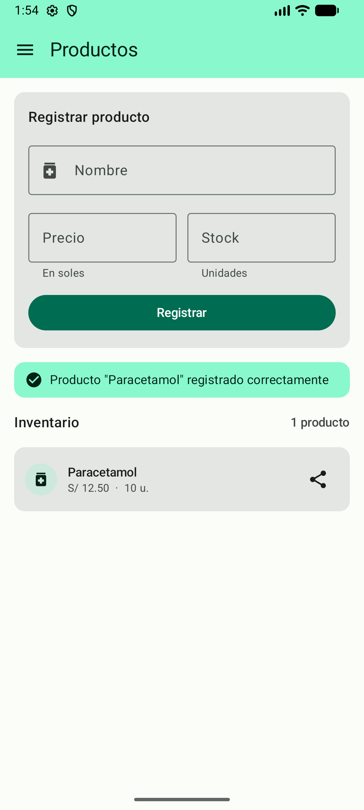
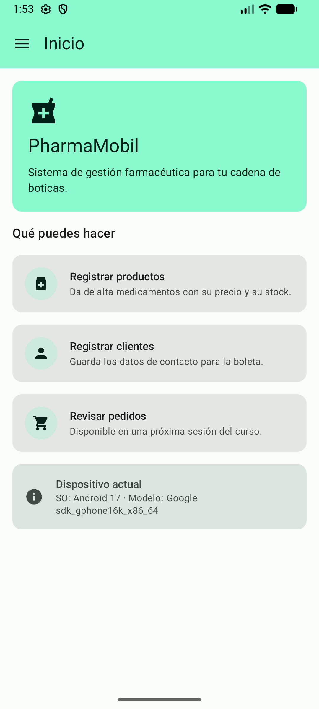

# Actividad Autónoma N.º 09
## Diferencias por plataforma y evidencia en iOS y Android

**Asignatura:** Desarrollo de Aplicaciones Móviles  
**Ciclo / Semestre:** Ciclo VI · Semestre 2026-2  
**Unidad 2:** Conectividad, CRUD REST y persistencia multiplataforma  
**Sesión 9:** Capacidades nativas con `expect`/`actual` en PharmaMobil  
**Proyecto:** PharmaMobil (Kotlin Multiplatform)  
**Modalidad:** Desarrollo Individual  

---

## Producto 1: Inventario de Capacidades Nativas

El siguiente inventario documenta las capacidades específicas de plataforma implementadas en el proyecto PharmaMobil, indicando la firma del contrato en el código común (`commonMain`), sus implementaciones correspondientes en cada plataforma (`androidMain` e `iosMain`), las APIs nativas utilizadas y las rutas exactas de los archivos fuente:

| Capacidad | Contrato (`commonMain`) | Implementación Android (`androidMain`) | Implementación iOS (`iosMain`) | APIs Nativas Utilizadas |
| :--- | :--- | :--- | :--- | :--- |
| **1. Formato de Moneda Peruana** | `expect fun formatearSoles(valor: Double): String`<br>*(Ruta: `shared/src/commonMain/kotlin/pe/edu/upeu/pharmamobil/platform/Formato.kt`)* | `actual fun formatearSoles(valor: Double): String`<br>*(Ruta: `shared/src/androidMain/kotlin/pe/edu/upeu/pharmamobil/platform/Formato.android.kt`)* | `actual fun formatearSoles(valor: Double): String`<br>*(Ruta: `shared/src/iosMain/kotlin/pe/edu/upeu/pharmamobil/platform/Formato.ios.kt`)* | **Android:** `java.text.NumberFormat` con `Locale("es", "PE")`<br>**iOS:** `NSNumberFormatter` con `NSLocale("es_PE")` |
| **2. Compartir Producto** | `interface Compartidor`<br>*(Ruta: `shared/src/commonMain/kotlin/pe/edu/upeu/pharmamobil/domain/platform/Compartidor.kt`)* | `class CompartidorAndroid(contexto: Context) : Compartidor`<br>*(Ruta: `shared/src/androidMain/kotlin/pe/edu/upeu/pharmamobil/platform/CompartidorAndroid.kt`)* | `class CompartidorIos : Compartidor`<br>*(Ruta: `shared/src/iosMain/kotlin/pe/edu/upeu/pharmamobil/platform/CompartidorIos.kt`)* | **Android:** `Intent(Intent.ACTION_SEND)` + `FLAG_ACTIVITY_NEW_TASK`<br>**iOS:** `UIActivityViewController` vía `rootViewController` |
| **3. Información del Dispositivo** *(Capacidad propia)* | `expect class InfoDispositivo()` | `actual class InfoDispositivo`<br>*(Ruta: `shared/src/androidMain/kotlin/pe/edu/upeu/pharmamobil/platform/InfoDispositivo.android.kt`)* | `actual class InfoDispositivo`<br>*(Ruta: `shared/src/iosMain/kotlin/pe/edu/upeu/pharmamobil/platform/InfoDispositivo.ios.kt`)* | **Android:** `android.os.Build.VERSION.RELEASE` y `Build.MODEL`<br>**iOS:** `UIDevice.currentDevice.systemName`, `systemVersion` y `model` |
| **4. Módulo de Inyección Koin** | `expect val platformModule: Module`<br>*(Ruta: `shared/src/commonMain/kotlin/pe/edu/upeu/pharmamobil/di/AppModule.kt`)* | `actual val platformModule: Module`<br>*(Ruta: `shared/src/androidMain/kotlin/pe/edu/upeu/pharmamobil/di/PlatformModule.android.kt`)* | `actual val platformModule: Module`<br>*(Ruta: `shared/src/iosMain/kotlin/pe/edu/upeu/pharmamobil/di/PlatformModule.ios.kt`)* | **Android:** `module { single<Compartidor> { CompartidorAndroid(androidContext()) } }`<br>**iOS:** `module { single<Compartidor> { CompartidorIos() } }` |

---

## Producto 2: Informe Comparativo de Diferencias

### 1. ¿Por qué la API de formato de moneda difiere entre plataformas si ambas usan el mismo locale?
Aunque tanto Android como iOS están configurados para representar la moneda en el ámbito peruano (`es_PE`), las máquinas virtuales y los entornos de ejecución subyacentes manejan subsistemas de localización totalmente independientes. En el entorno de Android (JVM), la formateación depende de la biblioteca Java Estándar mediante `java.text.NumberFormat`, la cual utiliza la base de datos de datos de localización Unicode CLDR integrada en la JVM de Android. Por otro lado, en iOS (Kotlin/Native sobre Darwin), la plataforma interactúa directamente con el marco de trabajo nativo **Foundation** de Apple utilizando `NSNumberFormatter` configurado con `NSLocale("es_PE")`.

Estas diferencias internas impactan en pequeños detalles sintácticos de salida: mientras que en Java `NumberFormat.getCurrencyInstance()` antepone la sigla monetaria con un espacio uniforme (por ejemplo, `S/ 12.50`), la implementación de Apple Foundation renderiza el símbolo según las convenciones específicas del sistema iOS (`S/ 12.50` o `S/12.50` según la versión exacta del sistema). Estas variaciones demuestran por qué no es conveniente reimplementar formateadores complejos manualmente en código común, sino delegar el comportamiento a la API nativa optimizada de cada sistema operativo.

### 2. ¿Por qué `CompartidorAndroid` necesita un `Context` y `CompartidorIos` no?
La discrepancia radica directamente en la arquitectura de componentes y manejo de contexto de la interfaz de usuario de cada sistema operativo. 

En Android, las operaciones del sistema operativo (como iniciar una nueva actividad para compartir contenido a través del selector de intents del sistema con `Intent.ACTION_SEND`) requieren una instancia explícita del objeto `android.content.Context`. Además, debido a que el contenedor de inyección de dependencias Koin en la capa global entrega el contexto de aplicación (`androidContext()`) y no el contexto de una `Activity` específica, Android impone el uso de la bandera `FLAG_ACTIVITY_NEW_TASK` al construir el selector de la actividad (`Intent.createChooser()`). Sin esta bandera, Android arroja una excepción `AndroidRuntimeException` en tiempo de ejecución.

En iOS (UIKit), la ventana activa (`UIApplication.sharedApplication.keyWindow`) mantiene la jerarquía global de controladores de vista. Para presentar la hoja de compartir nativa (`UIActivityViewController`), la implementación en Kotlin/Native navega directamente desde el objeto global `UIApplication` hacia el `rootViewController` de la ventana activa invocando el método `presentViewController()`. Por lo tanto, `CompartidorIos` no necesita recibir ningún contexto de aplicación en su constructor, simplificando su registro dentro del módulo Koin de iOS.

### 3. ¿Qué habría cambiado si en lugar de `expect`/`actual` hubieras usado una interfaz con inyección de dependencias?
Ambas herramientas cumplen propósitos complementarios en la arquitectura de un proyecto Kotlin Multiplatform:

* **Mecanismos `expect`/`actual`:** Constituyen un contrato a nivel de compilador. Su principal ventaja es que el compilador de Kotlin verifica estrictamente la existencia de una implementación para cada plataforma en tiempo de compilación; si falta una declaración `actual`, el proyecto ni siquiera compila. Sin embargo, su acoplamiento directo dificulta la sustitución por dobles de prueba (mocks/fakes) en pruebas unitarias y no permite recibir dependencias complejas dinámicamente. Es la solución ideal para funciones puras y utilidades sin estado, como `formatearSoles()` o `InfoDispositivo`.

* **Interfaz con Inyección de Dependencias (Koin):** Permite desacoplar el contrato de dominio (`Compartidor`) de la tecnología concreta. Nos otorga la flexibilidad de inyectar dependencias del sistema (como `androidContext()`), además de facilitar enormemente las pruebas unitarias en `commonTest`, permitiendo registrar un `FakeCompartidor` en los tests de ViewModel sin depender de las APIs nativas de Android ni de iOS. 

En PharmaMobil combinamos ambas estrategias óptimamente: la abstracción de compartir se declaró como interfaz en `domain`, e inyectamos sus implementaciones de plataforma usando `platformModule`, que en sí mismo está declarado como un `expect val platformModule: Module`.

### 4. ¿Qué ocurre si una de las dos implementaciones `actual` no existe?
Al provocar deliberadamente la omisión de una declaración `actual` (por ejemplo, eliminando temporalmente `Formato.android.kt` manteniendo la función `expect fun formatearSoles` en `commonMain`), el compilador interrumpe inmediatamente el proceso de compilación y emite el siguiente mensaje de error exacto y literal:

```text
Line 7: Error: No actual for expect declaration in module(s): androidMain, iosArm64Main, iosSimulatorArm64Main for the text `expect` on the line `expect fun formatearSoles(valor: Double): String`
```

Este comportamiento garantiza que no existan errores silenciosos ni excepciones inesperadas en tiempo de ejecución (`UnsatisfiedLinkError` o `ClassNotFoundException`), obligando al desarrollador a cumplir los contratos de plataforma antes de permitir la generación de los artefactos.

### 5. ¿Qué capacidad del proyecto NO debería bajar al código específico de plataforma y por qué?
Toda la lógica de negocio, validaciones de reglas de dominio y gestión de estados de la interfaz de usuario deben permanecer obligatoriamente en `commonMain`. Un ejemplo concreto en PharmaMobil es la validación y registro del formulario de productos (`RegistrarProductoUseCase` y `ProductoViewModel`).

Reglas como verificar que el nombre del producto no esté vacío, que el precio sea un número decimal mayor a cero y que el stock no sea negativo, son reglas puras de dominio. Si bajáramos esta lógica a `androidMain` o `iosMain`, estaríamos duplicando código, violando el principio DRY (*Don't Repeat Yourself*), aumentando el riesgo de inconsistencias de negocio entre plataformas y perdiendo la capacidad de ejecutar pruebas unitarias automatizadas y centralizadas en `commonTest`.

---

## Producto 3: Tercera Capacidad Nativa (`InfoDispositivo`)

Se seleccionó e implementó la capacidad nativa de **Información del Dispositivo**, la cual consulta dinámicamente las propiedades del sistema operativo y hardware donde se está ejecutando la aplicación PharmaMobil.

### Declaración `expect` en `commonMain`
```kotlin
// shared/src/commonMain/kotlin/pe/edu/upeu/pharmamobil/platform/InfoDispositivo.kt
package pe.edu.upeu.pharmamobil.platform

expect class InfoDispositivo() {
    val sistema: String
    val version: String
    val modelo: String
}
```

### Implementación `actual` en Android (`androidMain`)
```kotlin
// shared/src/androidMain/kotlin/pe/edu/upeu/pharmamobil/platform/InfoDispositivo.android.kt
package pe.edu.upeu.pharmamobil.platform

import android.os.Build

actual class InfoDispositivo actual constructor() {
    actual val sistema: String = "Android"
    actual val version: String = Build.VERSION.RELEASE
    actual val modelo: String = "${Build.MANUFACTURER} ${Build.MODEL}"
}
```

### Implementación `actual` en iOS (`iosMain`)
```kotlin
// shared/src/iosMain/kotlin/pe/edu/upeu/pharmamobil/platform/InfoDispositivo.ios.kt
package pe.edu.upeu.pharmamobil.platform

import platform.UIKit.UIDevice

actual class InfoDispositivo actual constructor() {
    actual val sistema: String = UIDevice.currentDevice.systemName
    actual val version: String = UIDevice.currentDevice.systemVersion
    actual val modelo: String = UIDevice.currentDevice.model
}
```

### Integración en la Interfaz de Usuario Compose (`InicioScreen.kt`)
La capacidad nativa se muestra directamente en una tarjeta de la pantalla principal (`InicioScreen.kt`), consumiendo la información sin importar paquetes nativos de Android ni de UIKit:

```kotlin
@Composable
private fun InfoDispositivoCard() {
    val info = remember { InfoDispositivo() }

    Card(
        modifier = Modifier.fillMaxWidth(),
        colors = CardDefaults.cardColors(
            containerColor = MaterialTheme.colorScheme.surfaceVariant,
            contentColor = MaterialTheme.colorScheme.onSurfaceVariant
        )
    ) {
        Row(
            modifier = Modifier.padding(16.dp),
            verticalAlignment = Alignment.CenterVertically,
            horizontalArrangement = Arrangement.spacedBy(16.dp)
        ) {
            Icon(
                imageVector = Icons.Default.Info,
                contentDescription = null,
                modifier = Modifier.size(24.dp)
            )

            Column {
                Text(
                    text = "Dispositivo actual",
                    style = MaterialTheme.typography.titleSmall
                )
                Text(
                    text = "SO: ${info.sistema} ${info.version} · Modelo: ${info.modelo}",
                    style = MaterialTheme.typography.bodySmall
                )
            }
        }
    }
}
```

---

## Producto 4: Evidencias de Ejecución en Emulador y Dispositivo Real

### 1. Formato de Moneda e Inventario de Productos
Captura de pantalla de la sección de Inventario de Productos ejecutándose en el emulador Android, donde se evidencia el precio correctamente formateado con moneda peruana (`S/ 12.50`) a través de la función `formatearSoles()` y el botón **Compartir**:



### 2. Selector de Compartir Nativo de Android (`Intent.ACTION_SEND`)
Captura de pantalla del selector nativo del sistema operativo desplegado al presionar el botón de compartir del producto `Paracetamol`, mostrando el texto formateado en código común (`Paracetamol — S/ 12.50 · Stock: 10 u.`):


### 3. Tercera Capacidad Nativa (`InfoDispositivo`) en Pantalla de Inicio
Captura de pantalla de la pantalla de Inicio (`InicioScreen.kt`), mostrando la tarjeta informativa con los datos reales del dispositivo Android (`SO: Android 17 · Modelo: Google sdk_gphone16k_x86_64`):



---

## Conclusiones y Cumplimiento
* **Aislamiento de Código:** Se verificó la ausencia total de importaciones `android.*` y `platform.UIKit.*` en el paquete `commonMain`.
* **Pruebas y Verificación:** Se ejecutaron con éxito todas las pruebas unitarias (`./gradlew test`) y la compilación limpia del proyecto (`./gradlew :androidApp:assembleDebug`).
* **Documentación:** El archivo `README.md` fue actualizado con la tabla detallada de capacidades nativas.
